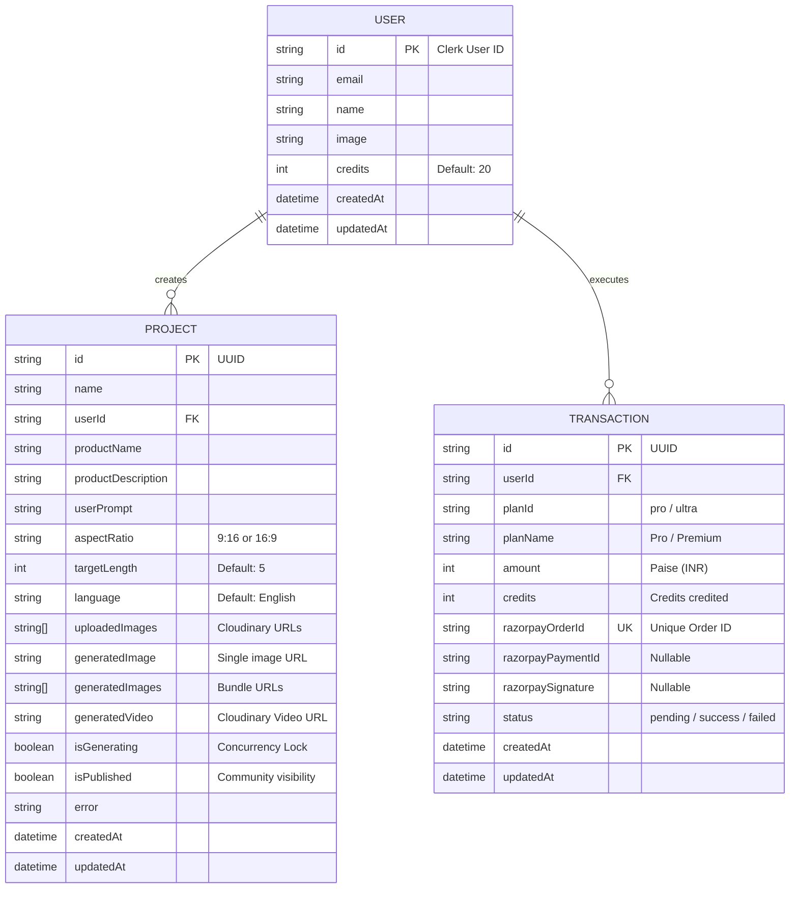
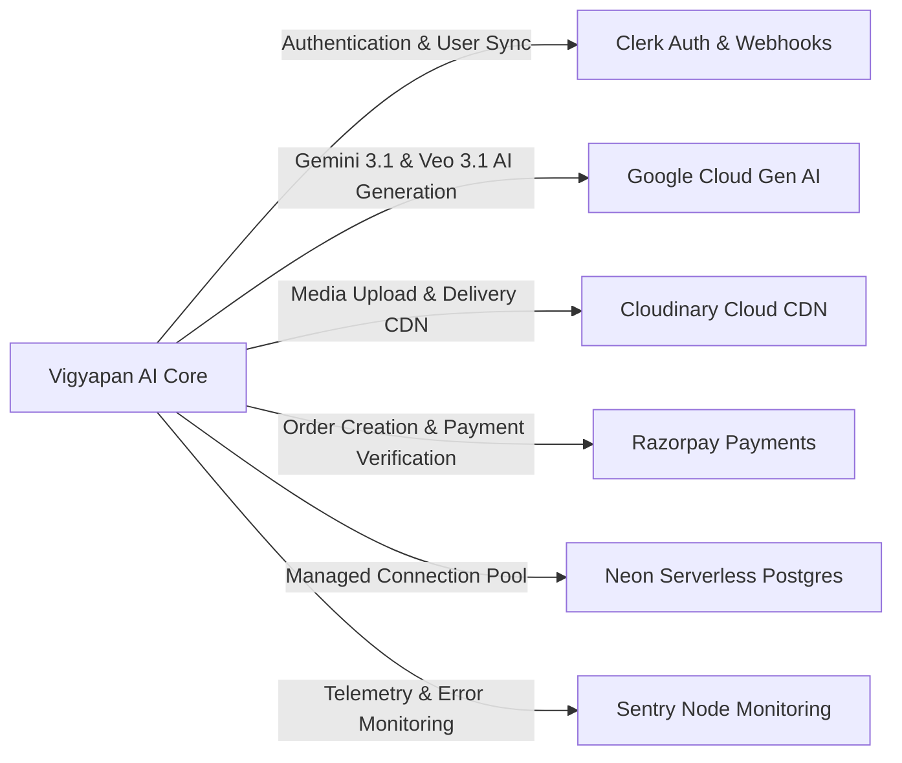
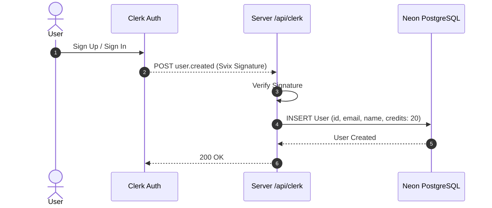
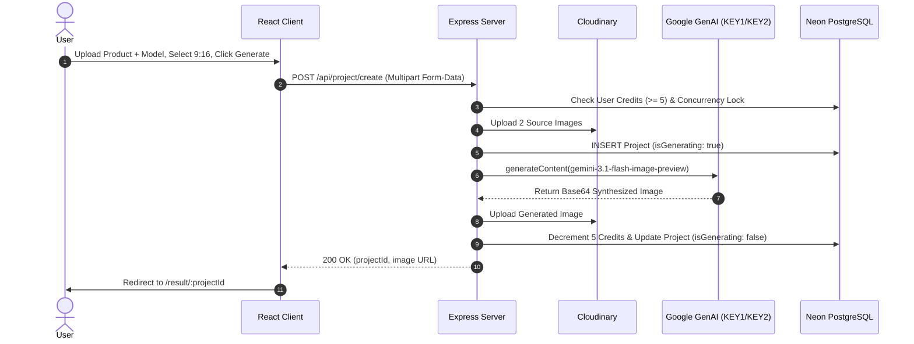
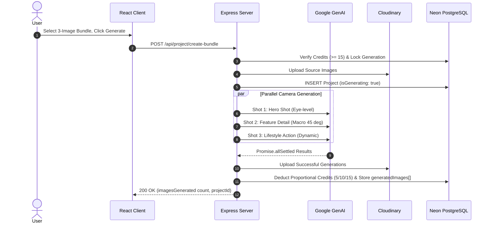
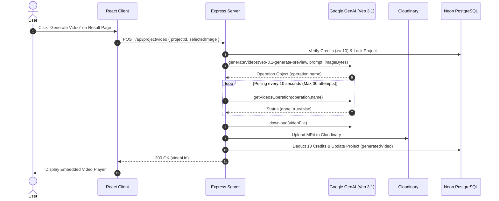
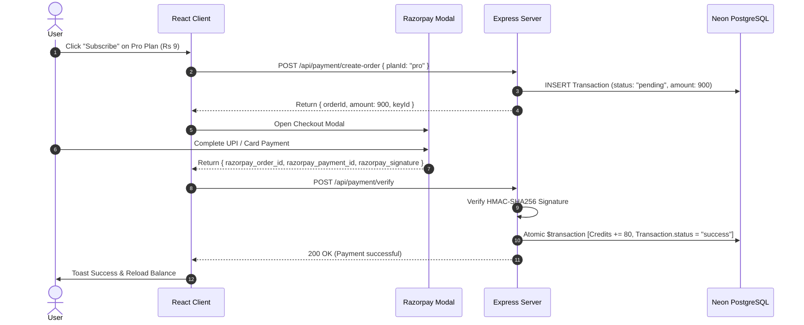

# Vigyapan AI (AdGen Studio) - Deep-Dive Project Analysis

> **Document Type**: Comprehensive System Architecture & Codebase Deep-Dive  
> **Repository**: `AI-ads-generator-editor-`  
> **Platform Name**: Vigyapan AI / AdGen Studio  
> **Current Version**: 2.0 (Multi-Key AI Fallback, 3-Image Bundle Generation, Veo 3.1 Video, Razorpay Payments)  
> **Primary Domains**: `vigyapanai.online`, Vercel preview environments, Render API backend  

---

## Table of Contents

1. [Executive Summary & Product Vision](#1-executive-summary--product-vision)
2. [Complete Technology Stack Matrix](#2-complete-technology-stack-matrix)
3. [System Architecture & High-Level Design](#3-system-architecture--high-level-design)
4. [Backend Deep Dive (`server/`)](#4-backend-deep-dive-server)
   - [Server Entry Point & Middleware Chain](#server-entry-point--middleware-chain)
   - [Cross-Origin Resource Sharing (CORS) Engine](#cross-origin-resource-sharing-cors-engine)
   - [Observability: Winston Logger & Sentry](#observability-winston-logger--sentry)
   - [Resilient AI Configuration Layer (`configs/ai.ts`)](#resilient-ai-configuration-layer-configsai)
   - [Project Controller & AI Generation Engines (`projectController.ts`)](#project-controller--ai-generation-engines)
   - [Payment Processing & Razorpay Gateway (`paymentController.ts`)](#payment-processing--razorpay-gateway)
   - [Clerk Webhooks & User Synchronization (`clerk.ts`)](#clerk-webhooks--user-synchronization)
   - [User & Project Management (`userController.ts`)](#user--project-management)
5. [Database Architecture & Data Modeling (`prisma/`)](#5-database-architecture--data-modeling-prisma)
   - [Prisma PostgreSQL Schema Specification](#prisma-postgresql-schema-specification)
   - [Neon Serverless Connection Pooling](#neon-serverless-connection-pooling)
   - [Database Maintenance & Credit Verification Script](#database-maintenance--credit-verification-script)
6. [Frontend Deep Dive (`client/`)](#6-frontend-deep-dive-client)
   - [Application Shell & Routing Architecture](#application-shell--routing-architecture)
   - [Design System, Glassmorphic Styling & Smooth Motion](#design-system-glassmorphic-styling--smooth-motion)
   - [Core Generator Studio (`Genetator.tsx`)](#core-generator-studio-genetatortsx)
   - [Result Studio & Video Generator (`Result.tsx`)](#result-studio--video-generator-resulttsx)
   - [User Generations & Community Discovery (`MyGenerations.tsx` & `Community.tsx`)](#user-generations--community-discovery)
   - [Plans & Payment Checkout UI (`Plans.tsx` & `Pricing.tsx`)](#plans--payment-checkout-ui)
7. [External Services & Integrations](#7-external-services--integrations)
8. [End-to-End System Workflows](#8-end-to-end-system-workflows)
   - [Flow 1: User Onboarding & Free Credit Initialization](#flow-1-user-onboarding--free-credit-initialization)
   - [Flow 2: Single Image Generation (5 Credits)](#flow-2-single-image-generation-5-credits)
   - [Flow 3: 3-Image Advertisement Bundle Generation (15 Credits)](#flow-3-3-image-advertisement-bundle-generation-15-credits)
   - [Flow 4: Veo 3.1 AI Video Generation (10 Credits)](#flow-4-veo-31-ai-video-generation-10-credits)
   - [Flow 5: Razorpay Plan Purchase & Instant Credit Top-Up](#flow-5-razorpay-plan-purchase--instant-credit-top-up)
9. [Complete REST API Specification](#9-complete-rest-api-specification)
10. [Deployment, Infrastructure & DevOps](#10-deployment-infrastructure--devops)
11. [Security, Concurrency & Resilience Guarantees](#11-security-concurrency--resilience-guarantees)
12. [Critical Findings, Architectural Insights & Future Roadmap](#12-critical-findings-architectural-insights--future-roadmap)

---

## 1. Executive Summary & Product Vision

**Vigyapan AI** (branded in the UI as **AdGen Studio**) is a full-stack, enterprise-grade SaaS platform built to democratize high-converting User-Generated Content (UGC) advertising. 

### The Core Problem Solved
Traditional commercial product shoots require booking studio space, hiring human models, staging lighting, camera crews, and manual post-production video editing. This workflow costs hundreds to thousands of dollars and takes days or weeks per product variation.

### The Vigyapan AI Solution
Vigyapan AI allows e-commerce merchants, digital agencies, and solo entrepreneurs to upload two simple raw photos:
1. **A Product Photo** (e.g., shoe, perfume bottle, beauty cream, watch).
2. **A Model Photo** (e.g., human subject posing, selfie, influencer portrait).

Using Google's state-of-the-art Generative AI models (`gemini-3.1-flash-image-preview` and `veo-3.1-generate-preview`), the system seamlessly synthesizes the person holding, using, or interacting with the product in a studio setting. Users can generate:
- **Single Studio Shots** (5 credits)
- **3-Image Commercial Bundles** with 3 distinct camera perspectives maintaining brand and facial consistency (15 credits):
  1. *Hero Shot*: Eye-level, centered, front-facing product showcase.
  2. *Feature Detail*: Macro 45-degree angle focusing on texture and product details.
  3. *Lifestyle Action*: Dynamic energetic shot of the subject actively using the product.
- **Dynamic AI Video Commercials** (10 credits) with multi-language script narration (English, Hindi, Hinglish, Spanish, French) powered by Veo 3.1.
- **Credit Recharge System** powered by Indian Rupee (INR) payments via Razorpay.

---

## 2. Complete Technology Stack Matrix

| Domain | Technology / Library | Version | Role in Architecture |
| :--- | :--- | :--- | :--- |
| **Frontend Framework** | React | `^19.2.0` | Declarative UI rendering, Concurrent Mode |
| **Frontend Bundler** | Vite | `^7.2.4` | Ultra-fast HMR and optimized production build |
| **Frontend Language** | TypeScript | `~5.9.3` | Static typing, interfaces, and compile-time checks |
| **Styling & Design** | TailwindCSS + Vite Plugin | `^4.1.17` | Utility-first CSS, modern dark/glassmorphic aesthetics |
| **Smooth Scrolling** | Lenis Scroll | `^1.3.16` | Inertia-based kinetic smooth scrolling |
| **Motion & Micro-interactions** | Framer Motion | `^12.23.26` | Fluid animations, page reveals, hover physics |
| **Icons** | Lucide React | `^0.555.0` | Vector icon library |
| **Notifications** | React Hot Toast | `^2.6.0` | Accessible toast alerts |
| **Client Routing** | React Router DOM | `^7.11.0` | Client-side routing, route params, navigation guards |
| **Client Authentication** | `@clerk/clerk-react`, `@clerk/themes` | `^5.59.2`, `^2.4.46` | Managed authentication widgets, JWT handling |
| **HTTP Client** | Axios | `^1.13.2` | REST API communication with 5-minute timeout |
| **Backend Runtime** | Node.js | `>=20.x` | Server-side JavaScript runtime |
| **Backend Framework** | Express.js | `^5.2.1` | Modern Express 5 HTTP server with async route support |
| **Backend Language** | TypeScript + `tsx` | `~5.9.3` / `^4.21.0` | Type-safe backend logic and on-the-fly execution |
| **Backend Auth & Webhooks**| `@clerk/express` | `^1.7.61` | Clerk Bearer token auth & webhook signature verification |
| **Database ORM** | Prisma Client + CLI | `^7.2.0` | Database schema migrations, queries, and connection pool |
| **PostgreSQL Driver** | `pg` + `@prisma/adapter-pg` | `^8.16.3` / `^7.2.0` | Node PostgreSQL client configured for Neon connection pool |
| **Generative AI** | `@google/genai` | `^1.35.0` | Google GenAI SDK for Gemini 3.1 & Veo 3.1 video generation |
| **Cloud Media Storage** | Cloudinary | `^2.8.0` | CDN-backed image and video asset persistence |
| **Multipart Uploads** | Multer | `^2.0.2` | Memory/disk multipart form-data processing |
| **Payment Gateway** | Razorpay SDK | `^2.9.6` | Payment order creation and cryptographic signature verification |
| **Logging & Auditing** | Winston | `^3.19.0` | Structured JSON logging, file transports, data masking |
| **Error Tracking** | Sentry Node | `^10.32.1` | Application performance monitoring and crash diagnostics |
| **Deployment Platforms** | Render & Vercel | Production | Render for backend API (`0.0.0.0:5001`), Vercel for client SPA |

---

## 3. System Architecture & High-Level Design

The application follows a decoupled client-server architecture with an asynchronous, polling-backed AI generation pipeline.

```
+---------------------------------------------------------------------------------------------------+
|                                          CLIENT TIER                                              |
|                                                                                                   |
|   React 19 SPA (Vite 7 + Tailwind 4)                                                              |
|   [Navbar | Home | Studio Generator | Result Carousel | Dashboard | Community | Pricing Modal]    |
|   - Clerk React Auth Context (JWT retrieval)                                                      |
|   - Razorpay Checkout SDK Modal (window.Razorpay)                                                |
|   - Axios Client (5-minute timeout guard)                                                        |
+-----------------------------------+---------------------------------------------------------------+
                                    |
                                    | HTTPS / JSON / Multipart Form-Data (Bearer JWT)
                                    v
+---------------------------------------------------------------------------------------------------+
|                                          SERVER TIER                                              |
|                                                                                                   |
|   Express 5 Application (server.ts)                                                               |
|   ├── Sentry Instrumentation (configs/instrument.mjs)                                             |
|   ├── CORS Policy Resolver (Regex loopback + Vercel domains + vigyapanai.online)                  |
|   ├── Clerk Raw Webhook Listener (/api/clerk)                                                     |
|   ├── Express JSON & Clerk Auth Middleware (clerkMiddleware())                                    |
|   ├── Request Logger (UUID Request-ID, Latency, Winston JSON File/Console)                        |
|   │                                                                                               |
|   ├── ROUTERS & CONTROLLERS:                                                                      |
|   │   ├── /api/user       --> userController (credits, my projects, toggle public)                |
|   │   ├── /api/project    --> projectController (single gen, bundle gen, video, reset, delete)    |
|   │   └── /api/payment    --> paymentController (Razorpay order, HMAC SHA-256 signature verify)  |
|   │                                                                                               |
|   ├── AI RESILIENCY LAYER (configs/ai.ts):                                                        |
|   │   └── Multi-Key Rotator (KEY1 -> KEY2 fallback upon 429/403/401/exhaustion)                  |
|   │                                                                                               |
|   └── Sentry Express Error Handler & Global Unhandled Rejection Traps                             |
+---------+----------------------------+-----------------------------+------------------------------+
          |                            |                             |
          | Cloudinary SDK             | Google GenAI SDK            | Prisma Client (@prisma/adapter-pg)
          v                            v                             v
+--------------------+       +---------------------+       +----------------------------------------+
|    CLOUDINARY      |       |   GOOGLE GEN AI     |       |          NEON POSTGRESQL               |
| Media Asset Cloud  |       | Gemini 3.1 Flash    |       | Serverless PostgreSQL Database         |
| - Original Uploads |       | Veo 3.1 Video Gen   |       | - User table (credits, Clerk ID)       |
| - Generated PNGs   |       | Polling Operations  |       | - Project table (assets, aspect ratio) |
| - Rendered MP4s    |       +---------------------+       | - Transaction table (Razorpay orders)  |
+--------------------+                                     +----------------------------------------+
```

---

## 4. Backend Deep Dive (`server/`)

### Server Entry Point & Middleware Chain
File: [`server/server.ts`](file:///e:/AI-ads-generator-editor-/server/server.ts)

The server initializes in a deterministic sequence to guarantee error instrumentation and webhook integrity:
1. **Sentry Instrument**: Loaded before everything via `import "./configs/instrument.mjs"`.
2. **CORS Configuration**: A dynamic origin validation function inspecting incoming `Origin` headers:
   - Matches local development environments via regex: `/^http:\/\/(localhost|127\.0\.0\.1)(:\d+)?$/`.
   - Matches Vercel deployments and branch previews: `/^https:\/\/([a-zA-Z0-9_-]+\.)*vercel\.app$/`.
   - Matches production domains: `/^https?:\/\/([a-zA-Z0-9_-]+\.)*vigyapanai\.online$/`.
   - Matches explicit origins configured in `process.env.CLIENT_URL` (comma-separated).
3. **Clerk Webhook Endpoint**: Mounted at `/api/clerk` using `express.raw({ type: 'application/json' })`. This **must precede** `express.json()` because cryptographic webhook signature verification requires raw payload bytes.
4. **Body Parsing & Auth**: `express.json()` and `clerkMiddleware()` parse JSON and attach user auth context to `req`.
5. **Request Logging**: Custom `requestLogger` logs HTTP method, URL, client IP, user ID, and execution duration in milliseconds.
6. **5-Minute Timeout**: The HTTP server socket timeout is explicitly configured to `300000ms` (`server.setTimeout(300000)`) to accommodate heavy AI video rendering pipelines.
7. **Signal Trapping**: Intercepts `SIGINT`, `SIGTERM`, `unhandledRejection`, and `uncaughtException` for clean process teardown.

---

### Observability: Winston Logger & Sentry
Files: [`server/configs/logger.ts`](file:///e:/AI-ads-generator-editor-/server/configs/logger.ts), [`server/middlewares/requestLogger.ts`](file:///e:/AI-ads-generator-editor-/server/middlewares/requestLogger.ts)

The backend features production-grade structured logging:
- **Dual File Transports**: Writes rotating logs to `logs/combined.log` and error logs to `logs/error.log` (5MB max size, 5 backup files).
- **Console Transport**: Active in development with colorized timestamps and levels.
- **Sensitive Key Masking**: `maskSensitive()` recursively traverses log metadata and redacts credentials matching `password`, `token`, `apiKey`, `secret`, `authorization`, `cookie`, `CLERK_SECRET_KEY`, `CLOUDINARY_API_SECRET`, and `GOOGLE_API_KEY`.
- **Request Context Injection**: Every HTTP request receives a unique UUID in `req.requestId` that persists through all controller logs.

---

### Resilient AI Configuration Layer (`configs/ai.ts`)
File: [`server/configs/ai.ts`](file:///e:/AI-ads-generator-editor-/server/configs/ai.ts)

One of the most sophisticated backend components is the multi-key failover manager:
- **API Key Pool**: Loads `GOOGLE_CLOUD_API_KEY1` and `GOOGLE_CLOUD_API_KEY2`.
- **Error Classifier (`isKeyExhaustedError`)**: Detects quota exhaustion by matching HTTP statuses (`429`, `403`, `401`, `400`) and error message substrings such as `quota`, `rate limit`, `resource_exhausted`, `billing`, `credit`, `payment required`, `api key not valid`, `apikey`, `key expired`, `insufficient`, or `invalid_argument`.
- **Round-Robin Fallback Strategy (`withKeyFallback`)**:
  - Always begins execution with `KEY1` so that if a key's quota resets, it is naturally reused.
  - If `KEY1` encounters a quota/key error, it automatically falls back to `KEY2` without terminating the user request.
  - Non-quota errors (e.g. prompt safety violation, invalid image file) fail fast without rotating keys.
- **Drop-in Compatible Proxy**: Exports `aiWithFallback` mirroring the `@google/genai` client methods:
  - `ai.models.generateContent`
  - `ai.models.generateVideos`
  - `ai.operations.getVideosOperation`
  - `ai.files.download`

---

### Project Controller & AI Generation Engines
File: [`server/controllers/projectController.ts`](file:///e:/AI-ads-generator-editor-/server/controllers/projectController.ts)

#### 1. Single Image Generation (`createProject`) - 5 Credits
- Validates user credit balance ($\ge 5$).
- Enforces single concurrency: Checks if user has an active `isGenerating: true` job. Automatically resets locks older than 2 minutes (crash recovery).
- Uploads both images (product and model) to Cloudinary concurrently (`Promise.all`).
- Creates a database `Project` entry in `isGenerating: true` state.
- Executes `ai.models.generateContent` with:
  - Model: `gemini-3.1-flash-image-preview`
  - Modalities: `['TEXT', 'IMAGE']`
  - Safety thresholds set to `OFF` for maximum creative freedom.
  - Studio lighting, perspective matching, and consistency prompt.
- Extracts returned base64 image, uploads to Cloudinary, and stores the secure URL in `generatedImage`.
- Atomically decrements 5 credits from `User`. If generation fails, credits remain intact.

#### 2. 3-Image Advertisement Bundle Generation (`createProjectBundle`) - 15 Credits
- Designed for marketing multi-angle campaigns.
- Validates credit balance ($\ge 15$).
- Defines three distinct cinematic camera angles:
  ```typescript
  const AD_ANGLES = [
    {
      name: "Hero Shot",
      camera: "Eye-level, front-facing, centered composition, product-focused, professional studio lighting"
    },
    {
      name: "Feature Detail",
      camera: "Macro side view, 45-degree angle, dramatic lighting showing product details and texture"
    },
    {
      name: "Lifestyle Action",
      camera: "Dynamic action shot, person actively using the product, natural movement, energetic composition"
    }
  ];
  ```
- Injects a strict consistency instruction prompt:
  > *"CRITICAL: The person's facial features, clothing, and overall appearance must be IDENTICAL in all shots to maintain brand continuity. Same person, same outfit, same styling throughout all angles."*
- **Parallel Execution with `Promise.allSettled`**:
  - Spawns 3 simultaneous AI requests, each with a 90-second timeout guard.
  - Uploads all fulfilled images to Cloudinary.
  - Updates `Project.generatedImages` array.
- **Fair Credit Charging & Graceful Degradation**:
  - If all 3 succeed: Deducts 15 credits.
  - If 1 or 2 succeed: Deducts proportional credits (5 or 10 credits).
  - If all 3 fail: Deducts 0 credits, rolls back project status, and returns a detailed error.

#### 3. Veo 3.1 Video Generation Engine (`createVideo`) - 10 Credits
- Validates credit balance ($\ge 10$).
- Selects the target image: Supports either a user-selected bundle image, the primary generated image, or the first image in the bundle.
- Fetches the image as binary array buffer via Axios and converts to base64.
- Injects a localized narration prompt based on the project's selected language:
  - **English**: High-energy, engaging UGC style.
  - **Hindi**: Natural conversational Hindi with Devanagari script cues.
  - **Hinglish**: Trendy blend of Hindi and English.
  - **Spanish** & **French**: Native phrasing and enthusiastic marketing cadence.
- Triggers `ai.models.generateVideos`:
  - Model: `veo-3.1-generate-preview`
  - Aspect Ratio: Match project aspect ratio (`9:16` or `16:9`).
  - Resolution: `720p`.
- **Long-Polling Loop**:
  - Polls `ai.operations.getVideosOperation` every 10 seconds.
  - Max attempts: 30 cycles (5 minutes timeout).
  - Downloads completed video file stream, saves to a temporary file on disk, streams to Cloudinary (`resource_type: 'video'`), and unlinks the local temp file.
- Deducts 10 credits upon verified video upload.

#### 4. Safety & Maintenance Routes
- `resetGeneration`: Allows the client to manually clear a stuck generation lock for a project.
- `deleteProject`: Deletes the project record from PostgreSQL (cascading cleanup).
- `getAllPublishedProjects`: Public endpoint fetching projects marked `isPublished: true` for the community feed.

---

### Payment Processing & Razorpay Gateway
File: [`server/controllers/paymentController.ts`](file:///e:/AI-ads-generator-editor-/server/controllers/paymentController.ts)

The platform supports Indian Rupee (INR) transactions via Razorpay with complete cryptographic verification:

#### Tier Pricing Configuration
- **Starter Plan**: ₹0 (Free forever, 20 signup credits).
- **Pro Plan**: ₹9 (900 paise, 80 credits).
- **Ultra Plan**: ₹29 (2900 paise, 240 credits).

#### Order Creation (`createOrder`)
1. Validates user authentication via Clerk.
2. Creates an order via `razorpay.orders.create({ amount, currency: 'INR', receipt, notes })`.
3. Creates a `Transaction` row in the database with status `pending`.
4. Returns `orderId`, `amount`, `currency`, and `keyId` to the client.

#### Cryptographic Payment Verification (`verifyPayment`)
1. Computes expected HMAC SHA-256 signature:
   $$\text{ExpectedSignature} = \text{HMAC-SHA256}(\text{order\_id} + "|" + \text{payment\_id}, \text{RAZORPAY\_KEY\_SECRET})$$
2. Compares against `razorpay_signature` provided by client checkout.
3. If valid, executes an atomic Prisma transaction:
   ```typescript
   await prisma.$transaction([
       prisma.user.update({
           where: { id: userId },
           data: { credits: { increment: transaction.credits } }
       }),
       prisma.transaction.update({
           where: { razorpayOrderId: razorpay_order_id },
           data: {
               status: 'success',
               razorpayPaymentId: razorpay_payment_id,
               razorpaySignature: razorpay_signature
           }
       })
   ]);
   ```
4. Implements idempotency: If the transaction is already marked `success`, returns early without duplicate credit increments.

---

### Clerk Webhooks & User Synchronization
File: [`server/controllers/clerk.ts`](file:///e:/AI-ads-generator-editor-/server/controllers/clerk.ts)

Handles asynchronous webhook notifications from Clerk:
- `user.created`: Creates a new record in the PostgreSQL `User` table with an initial balance of **20 free credits**.
- `user.updated`: Synchronizes user name, email, and avatar changes.
- `user.deleted`: Removes user and cascades project deletions.
- `paymentAttempt.updated`: Backup handler for Clerk Stripe Billing events (`pro` = 80 credits, `premium` = 240 credits).

---

## 5. Database Architecture & Data Modeling (`prisma/`)

The database is hosted on **Neon Serverless PostgreSQL** and managed through **Prisma 7**.

### Prisma PostgreSQL Schema Specification
File: [`server/prisma/schema.prisma`](file:///e:/AI-ads-generator-editor-/server/prisma/schema.prisma)



### Neon Serverless Connection Pooling
File: [`server/configs/prisma.ts`](file:///e:/AI-ads-generator-editor-/server/configs/prisma.ts)

Serverless databases like Neon go to sleep after periods of inactivity. To prevent connection drops or cold-start timeouts:
- Uses `pg.Pool` with `@prisma/adapter-pg`.
- Configured with `max: 10` connections.
- `connectionTimeoutMillis: 30000`: Allows 30 seconds for the database compute instance to wake up before throwing a timeout.
- `idleTimeoutMillis: 30000`: Cleans up idle connections to stay within Neon free/tier limits.

### Database Maintenance & Credit Verification Script
File: [`server/scripts/verify-credits.ts`](file:///e:/AI-ads-generator-editor-/server/scripts/verify-credits.ts)

An operational CLI utility script to audit user credit health across the database:
- Scans all users in the PostgreSQL database.
- Identifies any accounts with $\le 0$ credits.
- Provides automatic correction to reset any corrupted or drained user accounts back to 20 credits.

---

## 6. Frontend Deep Dive (`client/`)

### Application Shell & Routing Architecture
Files: [`client/src/App.tsx`](file:///e:/AI-ads-generator-editor-/client/src/App.tsx), [`client/src/main.tsx`](file:///e:/AI-ads-generator-editor-/client/src/main.tsx)

The frontend is a single-page application built on React 19 and React Router v7.

#### Route Map:
| Path | Component | Description | Access Level |
| :--- | :--- | :--- | :--- |
| `/` | `Home.tsx` | Landing page (Hero, Features, Pricing, FAQ, CTA) | Public |
| `/generate` | `Genetator.tsx` | AI Ads Studio for uploading and generating images | Authenticated |
| `/result/:projectId` | `Result.tsx` | Detailed view of generated images, bundle carousel, video generator | Authenticated |
| `/my-generations` | `MyGenerations.tsx` | User project dashboard with masonry grid | Authenticated |
| `/community` | `Community.tsx` | Public community gallery of published generations | Public |
| `/plans` | `Plans.tsx` | Pricing table and Razorpay subscription portal | Public / Auth |
| `/loading` | `Loading.tsx` | Standalone full-screen animated loader | Public |

Global components wrapped around all views:
- `Toaster`: Configured with dark theme (`bg: #333`, `color: #fff`).
- `SoftBackdrop`: Ambient gradient spheres and noise backdrop overlay.
- `LenisScroll`: Smooth inertial scrolling listener.
- `Navbar`: Displays logo, navigation links, credit count badge, and Clerk `UserButton`.

---

### Design System, Glassmorphic Styling & Smooth Motion
- **CSS Architecture**: Modern Tailwind v4 with custom utilities in `src/index.css`.
- **Glassmorphism**: `.glass-panel` utility class providing backdrop blur, translucent background fills, and subtle border highlights.
- **Animations**:
  - Floating image avatars (`animate-float`) showcasing original input photos.
  - Spinner animations for generation progress (`Loader2Icon animate-spin`).
  - Smooth page transitions and button hover states.

---

### Core Generator Studio (`Genetator.tsx`)
File: [`client/src/pages/Genetator.tsx`](file:///e:/AI-ads-generator-editor-/client/src/pages/Genetator.tsx)

The primary studio interface where users create ads:
1. **Dual Upload Zones**:
   - Product Image upload with drag & drop preview.
   - Model Image upload with drag & drop preview.
2. **Project Configurations**:
   - Project Name & Product Name inputs.
   - Product Description (optional marketing context).
   - Custom User Prompt (controls style, setting, mood).
   - Aspect Ratio Switcher: Vertical `9:16` (Stories, Reels, Shorts) vs Horizontal `16:9` (YouTube, web banners).
   - Narration Language Dropdown: English, Hindi, Hinglish, Spanish, French.
3. **Generation Type Selector**:
   - **Single Image**: 5 credits.
   - **3-Image Bundle**: 15 credits (Hero, Detail, Action shots).
4. **Execution**:
   - Packages parameters into `FormData`.
   - Dispatches to `/api/project/create` or `/api/project/create-bundle`.
   - On success, displays a toast alert and navigates directly to `/result/:projectId`.

---

### Result Studio & Video Generator (`Result.tsx`)
File: [`client/src/pages/Result.tsx`](file:///e:/AI-ads-generator-editor-/client/src/pages/Result.tsx)

The output inspection and transformation suite:
- **Image Showcase**:
  - Single Mode: Large responsive image preview with aspect ratio preservation.
  - Bundle Mode: Interactive 3-thumbnail carousel (Hero, Detail, Action). Clicking any thumbnail updates the active stage preview.
- **Download Center**:
  - Individual asset downloads using Cloudinary's dynamic attachment parameter (`/upload/fl_attachment`).
  - **Download All Images**: Iterates through all images in the bundle and programmatically triggers simultaneous downloads.
- **Video Magic Station**:
  - Generates a cinematic video from the currently selected image.
  - Displays selected narration language badge.
  - Initiates long-running video request to `/api/project/video`.
  - Seamlessly replaces image view with an HTML5 video player with controls once generated.

---

### User Generations & Community Discovery
Files: [`client/src/pages/MyGenerations.tsx`](file:///e:/AI-ads-generator-editor-/client/src/pages/MyGenerations.tsx), [`client/src/pages/Community.tsx`](file:///e:/AI-ads-generator-editor-/client/src/pages/Community.tsx), [`client/src/components/ProjectCard.tsx`](file:///e:/AI-ads-generator-editor-/client/src/components/ProjectCard.tsx)

- **Masonry Layout**: Uses CSS multi-column layouts (`columns-1 sm:columns-2 lg:columns-3 gap-4`) to accommodate mixed vertical (`9:16`) and horizontal (`16:9`) cards without visual clipping.
- **Project Card Details**:
  - Status badges (`Generating`, `Published`, `Bundle: 3`).
  - Floating dual circular thumbnails showing the source product and model photos.
  - Aspect ratio pill, timestamp, and product description preview.
  - Dropdown menu for individual image downloads, video download, native web sharing (`navigator.share`), and project deletion.
  - One-click **Publish / Unpublish** toggle to share creations on the public `/community` feed.

---

### Plans & Payment Checkout UI
Files: [`client/src/pages/Plans.tsx`](file:///e:/AI-ads-generator-editor-/client/src/pages/Plans.tsx), [`client/src/components/Pricing.tsx`](file:///e:/AI-ads-generator-editor-/client/src/components/Pricing.tsx), [`client/src/services/payment.ts`](file:///e:/AI-ads-generator-editor-/client/src/services/payment.ts)

- Communicates with `/api/payment/create-order` and `/api/payment/verify`.
- Dynamically loads the Razorpay checkout overlay (`new window.Razorpay(options)`).
- Automatically prefills user profile data (name, email) from Clerk context.
- Verifies transaction upon checkout completion and reloads user balance seamlessly.

---

## 7. External Services & Integrations



### Integration Details:
1. **Google Cloud Gen AI**:
   - `gemini-3.1-flash-image-preview`: Fast image synthesis combining dual image buffers with camera instructions.
   - `veo-3.1-generate-preview`: Advanced video generation model producing 720p social-ready MP4s from static images.
2. **Cloudinary**:
   - Cloud storage for user input uploads and generated media.
   - Dynamic transformation URL manipulation: inserting `/upload/fl_attachment` forces browser file download instead of preview.
3. **Clerk**:
   - Handles multi-factor authentication, OAuth social sign-in, and JWT generation.
   - Synchronizes user profile lifecycle via Svix-signed webhooks to `/api/clerk`.
4. **Razorpay**:
   - Handles Indian debit/credit cards, UPI, net banking, and wallets.
   - Cryptographic HMAC-SHA256 signature verification guarantees transaction non-repudiation.
5. **Sentry**:
   - Captures runtime crashes and logs exceptions with call stacks.

---

## 8. End-to-End System Workflows

### Flow 1: User Onboarding & Free Credit Initialization


### Flow 2: Single Image Generation (5 Credits)


### Flow 3: 3-Image Advertisement Bundle Generation (15 Credits)


### Flow 4: Veo 3.1 AI Video Generation (10 Credits)


### Flow 5: Razorpay Plan Purchase & Instant Credit Top-Up


---

## 9. Complete REST API Specification

### Authentication
All protected routes require a standard Bearer Token header:
```
Authorization: Bearer <clerk_jwt_token>
```

### Endpoints Summary

#### 1. Project Endpoints (`/api/project`)
| Method | Endpoint | Auth | Description | Payload / Params |
| :--- | :--- | :--- | :--- | :--- |
| `POST` | `/api/project/create` | Yes | Generates a single AI image (5 credits) | `multipart/form-data`: `images` (2 files), `name`, `productName`, `productDescription`, `userPrompt`, `aspectRatio` |
| `POST` | `/api/project/create-bundle`| Yes | Generates 3-angle bundle (15 credits) | `multipart/form-data`: `images` (2 files), `name`, `productName`, `productDescription`, `userPrompt`, `aspectRatio` |
| `POST` | `/api/project/video` | Yes | Generates Veo 3.1 video (10 credits) | JSON: `{ projectId: string, selectedImage?: string }` |
| `GET` | `/api/project/published` | No | Retrieves all public projects | Query: None |
| `DELETE`| `/api/project/:projectId`| Yes | Permanently deletes a user project | Route param: `projectId` |
| `POST` | `/api/project/reset-generation` | Yes | Clears stuck generation lock | JSON: `{ projectId: string }` |

#### 2. User Endpoints (`/api/user`)
| Method | Endpoint | Auth | Description | Payload / Params |
| :--- | :--- | :--- | :--- | :--- |
| `GET` | `/api/user/credits` | Yes | Retrieves current available credits | None |
| `GET` | `/api/user/projects` | Yes | Fetches all projects created by user | None |
| `GET` | `/api/user/projects/:projectId` | Yes | Fetches full project details by ID | Route param: `projectId` |
| `GET` | `/api/user/publish/:projectId` | Yes | Toggles public visibility flag | Route param: `projectId` |

#### 3. Payment Endpoints (`/api/payment`)
| Method | Endpoint | Auth | Description | Payload / Params |
| :--- | :--- | :--- | :--- | :--- |
| `POST` | `/api/payment/create-order` | Yes | Generates a Razorpay order | JSON: `{ planId: "pro" \| "ultra" }` |
| `POST` | `/api/payment/verify` | Yes | Verifies signature & credits user | JSON: `{ razorpay_order_id, razorpay_payment_id, razorpay_signature }` |

#### 4. Webhooks & System Endpoints
| Method | Endpoint | Auth | Description | Payload / Params |
| :--- | :--- | :--- | :--- | :--- |
| `POST` | `/api/clerk` | Svix | Clerk user and payment lifecycle events | Raw JSON Body + Svix Headers |
| `GET` | `/` | No | Basic server health check | Returns `"Server is Live!"` |
| `GET` | `/debug-sentry` | No | Throws an intentional error for Sentry | None |

---

## 10. Deployment, Infrastructure & DevOps

### Production Build & Deployment Topology
The repository is split into two deployable artifacts:

```
[GitHub Repository]
       ├── server/  ──> Render Web Service (ai-ads-generator-api)
       └── client/  ──> Vercel SPA Deployment (vigyapanai.online)
```

#### Render Deployment Configuration (`render.yaml`)
- **Runtime**: Node.js
- **Root Directory**: `server`
- **Build Command**: `npm install && npx prisma generate && npm run build`
- **Postbuild Hook**: Executes `configs/instrument.mjs` copy script:
  ```json
  "postbuild": "node -e \"import('node:fs').then(fs => { fs.mkdirSync('dist/configs', { recursive: true }); fs.copyFileSync('configs/instrument.mjs', 'dist/configs/instrument.mjs'); })\""
  ```
- **Start Command**: `npm run start:prod` (executes `node dist/server.js`)
- **Health Check Path**: `/`

#### Vercel Single-Page App Rewrites (`client/vercel.json`)
Redirects all incoming browser route requests back to `/index.html` to allow React Router DOM to manage client-side routing:
```json
{
  "rewrites": [
    {
      "source": "/(.*)",
      "destination": "/index.html"
    }
  ]
}
```

### Environment Variables Master Directory

#### Backend (`server/.env`):
| Variable Name | Required | Description |
| :--- | :---: | :--- |
| `PORT` | Optional | HTTP listen port (defaults to `5001`) |
| `NODE_ENV` | Yes | Environment mode (`development` or `production`) |
| `LOG_LEVEL` | Optional | Winston log level filter (`debug`, `info`, `warn`, `error`) |
| `CLIENT_URL` | Yes | Comma-separated list of allowed frontend origins |
| `DATABASE_URL` | Yes | Neon PostgreSQL pooled connection string |
| `DIRECT_URL` | Yes | Neon PostgreSQL direct migration connection string |
| `CLERK_PUBLISHABLE_KEY` | Yes | Clerk public API key |
| `CLERK_SECRET_KEY` | Yes | Clerk backend private secret key |
| `CLERK_WEBHOOK_SIGNING_SECRET`| Yes | Svix secret for authenticating `/api/clerk` webhooks |
| `CLOUDINARY_URL` | Yes | Cloudinary connection URI including credentials |
| `GOOGLE_CLOUD_API_KEY1` | Yes | Primary Google GenAI API key |
| `GOOGLE_CLOUD_API_KEY2` | Yes | Secondary fallback Google GenAI API key |
| `RAZORPAY_KEY_ID` | Yes | Razorpay API public key |
| `RAZORPAY_KEY_SECRET` | Yes | Razorpay API private secret |
| `SENTRY_DSN` | Optional | Sentry error tracking DSN |

#### Frontend (`client/.env`):
| Variable Name | Required | Description |
| :--- | :---: | :--- |
| `VITE_BASEURL` | Yes | Backend API base URL (e.g. `https://api.vigyapanai.online`) |
| `VITE_CLERK_PUBLISHABLE_KEY` | Yes | Clerk public key for auth widgets |
| `VITE_RAZORPAY_KEY_ID` | Yes | Razorpay public key for client checkout modal |

---

## 11. Security, Concurrency & Resilience Guarantees

1. **Non-Blocking Quota Failover**:
   Google Cloud API quotas are heavily guarded. By routing all AI generation through `withKeyFallback`, quota exhaustion (`429` / `RESOURCE_EXHAUSTED`) on `KEY1` automatically shifts execution to `KEY2`.
2. **Double-Spend & Concurrency Prevention**:
   A user cannot spam the "Generate" button to trigger multiple costly parallel calls. Every generation sets `isGenerating: true` on the database level. Subsequent requests are rejected with `429 Too Many Requests`.
3. **Automatic Stale-Lock Recovery**:
   If a worker process crashes mid-generation, stale locks older than 2 minutes are automatically cleared on subsequent calls:
   ```typescript
   const twoMinutesAgo = new Date(Date.now() - 2 * 60 * 1000);
   await prisma.project.updateMany({
       where: { userId, isGenerating: true, updatedAt: { lt: twoMinutesAgo } },
       data: { isGenerating: false, error: 'Generation timed out (auto-reset)' }
   });
   ```
4. **Zero-Credit Leakage**:
   Credits are only deducted **after** the generated assets are verified, uploaded to Cloudinary, and saved to the database. If any step fails, no credits are deducted.
5. **Cryptographic Payment Non-Repudiation**:
   Razorpay order verification is computed using HMAC-SHA256 with the server-only `RAZORPAY_KEY_SECRET`. Signatures cannot be spoofed by modifying client requests.
6. **Data Privacy**:
   Winston logs are automatically scrubbed of sensitive values (passwords, tokens, cookies, auth headers, and API keys) before writing to disk.

---

## 12. Critical Findings, Architectural Insights & Future Roadmap

### Notable Architectural Strengths
- **Graceful Partial Failure in Bundles**: Using `Promise.allSettled()` ensures that if 2 out of 3 angles succeed, the user still receives their images and is charged only 10 credits instead of failing the entire operation.
- **Neon Cold-Start Resiliency**: The 30-second connection timeout configuration prevents server crashes when database serverless instances spin up from zero.
- **Dynamic Attachment Downloads**: Using `/upload/fl_attachment` directly on Cloudinary URLs bypasses browser CORS issues when downloading media files.

### Identified Bottlenecks & Recommended Improvements

#### 1. Background Job Processing (Long-Polling Bottleneck)
- **Current Behavior**: Video generation blocks the HTTP request for up to 5 minutes while polling `getVideosOperation` in a while-loop.
- **Risk**: HTTP timeouts on edge proxies (e.g., Cloudflare 100s limit, Vercel Serverless 60s limit).
- **Recommendation**: Introduce a message queue (such as **BullMQ** with **Redis**). The HTTP endpoint should return a `jobId` immediately (`202 Accepted`), and the client should subscribe via Server-Sent Events (SSE) or WebSockets for real-time progress.

#### 2. Model Name Updates in Documentation
- **Observation**: Legacy documentation files (`TECHNICAL_DOCUMENTATION.md`) referenced older models (`Gemini 2.5 Flash Image`).
- **Resolution**: The codebase has been fully upgraded to `gemini-3.1-flash-image-preview` and `veo-3.1-generate-preview`. This document reflects the true, current state of the code.

#### 3. Image Bundle Scaling
- **Opportunity**: Currently, `AD_ANGLES` has 3 fixed camera setups. Exposing custom camera angle prompts or letting users select between 1, 3, or 5 bundle shots dynamically would increase flexibility.

---

## 13. Social Posting Engine (Instagram, Facebook & YouTube Shorts)

### Architecture & Capabilities Overview
Vigyapan AI now includes native direct social media publishing and automated scheduled background posting:
- **YouTube Shorts**: Direct streaming from Cloudinary to YouTube Resumable Upload API with `#Shorts` injection, automated token refresh (5-min proactive buffer), and Google quota management.
- **Facebook Pages**: Long-lived Page Access Token exchange (60-day longevity with automatic renewal), multi-page selector, and feed photo/video publishing.
- **Instagram**: Professional/Business account integration via parent Facebook Page tokens, containerized media creation with 5-second polling until `FINISHED`, and Cloudinary dynamic URL transformations (auto-padding 9:16 vertical photos to 4:5 ratio with black background to meet Instagram Feed specifications; H.264/AAC MP4 video transcoding).
- **AI Caption Studio**: Gemini-powered contextual caption generation with custom brand hashtags, persona tone settings, and optional AI disclosure badge (`✨ AI Disclosure: Generated with Vigyapan AI`).
- **Resilient Background Scheduler**: `node-cron` publisher running every 60 seconds with atomic database claims (`status: 'scheduled'` -> `'publishing'`), 10-minute zombie reaper, and exponential retry backoff ($2^{\text{attempts}}$ minutes clamped to 60 min).
- **Security & Hardening**: AES-256-GCM encryption for all tokens at rest, HMAC-SHA256 signed OAuth states with 10-minute TTL, Cloudinary URL domain whitelisting, platform caption length constraints, and Express rate limiting.

### Verification Test Suites Matrix
| Phase | Scope | Test Script | Status |
| :--- | :--- | :--- | :---: |
| **Phase 1** | Prisma Models, AES-256-GCM Crypto, Signed OAuth State, Logger Redaction | `server/scripts/test-phase1.ts` | 10/10 PASS |
| **Phase 2** | YouTube OAuth, Stream Upload to Resumable API, Shorts Formatting | `server/scripts/test-phase2.ts` | 13/13 PASS |
| **Phase 3** | Meta OAuth, Long-lived Page Tokens, Facebook Photo & Video Publishing | `server/scripts/test-phase3.ts` | 14/14 PASS |
| **Phase 4** | Instagram Containers, Polling Loop, Cloudinary 4:5 Dynamic Padding | `server/scripts/test-phase4.ts` | 13/13 PASS |
| **Phase 5** | AI Caption Generator, Immediate & Scheduled Post Controller, Client UI | `server/scripts/test-phase5.ts` | 8/8 PASS |
| **Phase 6** | Publisher Cron Lifecycle, Atomic Worker Claims, Zombie Reaper, Backoff | `server/scripts/test-phase6.ts` | 18/18 PASS |
| **Phase 7** | Hardening, Rate Limiting, SSRF Guard, Matrix Integration Tests | `server/scripts/test-phase7.ts` | 29/29 PASS |

---

*Analysis generated comprehensively across the full repository codebase. All references, schema definitions, route handlers, and configurations have been validated against active source files.*
